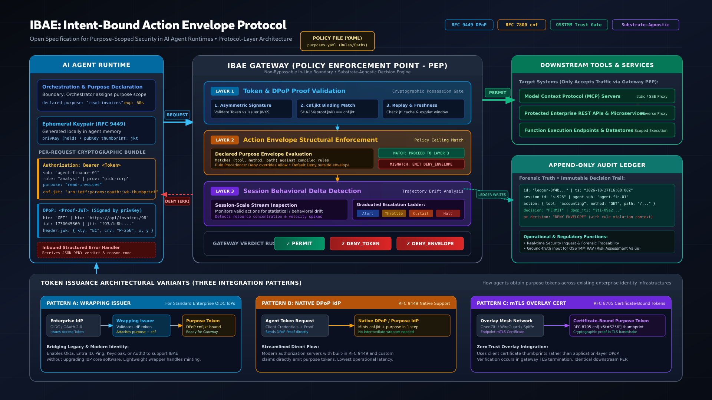

# IBAE: Intent-Bound Action Envelope Protocol

An open specification for purpose-scoped security in AI agent runtimes.

## What is IBAE?

IBAE defines a protocol for constraining AI agent actions to the scope of their declared purpose, enforced at the infrastructure layer, not inside the agent. It fills a critical gap in the current agent security landscape: a standardized Policy Enforcement Point (PEP) for agent sandboxes.

A compromised, jailbroken, or prompt-injected agent that tries to exceed its envelope gets blocked at the gateway before the request touches the downstream service. The agent's cooperation is not required.

## Core Mechanisms

- **Purpose-scoped tokens** with DPoP cryptographic binding (RFC 9449), tying every request to a specific agent, purpose, method, and timestamp
- **Structural action envelopes** defining exactly which tools, methods, and paths an agent may call for a given purpose, with default-deny enforcement
- **Session-level drift detection** monitoring behavioral patterns across permitted actions
- **Append-only audit ledger** providing a complete forensic record of every enforcement decision

## Specification

The full protocol specification is in [SPECIFICATION.md](SPECIFICATION.md).

## Architecture

## Integration Patterns

IBAE is substrate-agnostic. Three token-issuance patterns cover existing identity infrastructures:

- **Pattern A: Wrapping Issuer** for standard OIDC providers (Okta, Keycloak, Auth0, AD FS)
- **Pattern B: Native DPoP IdP** for providers with built-in RFC 9449 support
- **Pattern C: mTLS Overlay** for zero-trust mesh networks (OpenZiti, WireGuard)

Protocol adapters support MCP, OpenAI function calling, REST APIs, and LangChain.

## What This Spec Covers (and Doesn't)

**Open protocol (this repo):** Token format, enforcement pipeline, policy schema, delta-detection interface, ledger schema.

**Implementation-specific (not in this repo):** Detection algorithms, content scanning, deployment architecture, production hardening. These vary across vendors and deployments. The protocol is the interoperability surface; the implementation is the product.

## Attribution

IBAE is grounded in the security measurement framework of the [Open Source Security Testing Methodology Manual (OSSTMM)](https://www.isecom.org/OSSTMM.3.pdf), maintained by the [Institute for Security and Open Methodologies (ISECOM)](https://www.isecom.org). The OSSTMM concepts of Trust as measurable debt, operational controls, and Risk Assessment Values (RAV) inform the protocol's design philosophy.

## License

This specification is licensed under [Creative Commons Attribution-ShareAlike 3.0 (CC BY-SA 3.0)](https://creativecommons.org/licenses/by-sa/3.0/).

## Contributing

Feedback and contributions welcome via GitHub Issues and Pull Requests.
